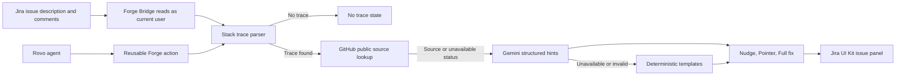

# CodeBuddy 2.0 for Jira

CodeBuddy 2.0 is a Forge Jira issue panel that finds Python, JavaScript/TypeScript, and Java stack traces in issue descriptions and comments, then offers **Nudge**, **Pointer**, and **Full fix** hints. It can use a linked public GitHub repository for a bounded source excerpt. Gemini is optional; a deterministic template path handles missing keys, timeouts, rate limits, service errors, and invalid model output.

## How it works



The app key remains `codebuddy-forge`; **CodeBuddy 2.0** is the display name. `src/services/analyzeIssue.ts` coordinates parsing, repository context, and hint generation. Each network stage is time-bounded within the 20-second analysis deadline.

## Install and run

### Judge install

**Install link:** [Owner: add the production Forge install link here after enabling app sharing in Developer Console]

Open the link, choose a Jira site, and approve the listed permissions. Open an issue in Jira's new issue view, then choose **CodeBuddy 2.0** from the issue's **•••** menu. The panel opens above Activity. To use the Rovo integration, open the Rovo agent picker and choose **CodeBuddy 2.0**; availability depends on the site's Rovo access and app installation.

### Configure issue content

Put a supported trace in the issue description or a comment. To request source context, add a public GitHub repository URL as plain text, a Jira link, or a smart link in the same description/comment. The trace's file path should match a repository file. Private repositories cannot be read. No GitHub token is used.

### Deploy your own development environment

Requirements: Node.js 24, npm, Forge CLI, and an Atlassian development site. From the repository root:

```powershell
npm ci
npm run lint
npm run build
npm test
forge login
forge lint
forge deploy --non-interactive -e development
forge install --non-interactive --site YOUR-SITE.atlassian.net --product jira --environment development
```

Optionally set Gemini's encrypted key for the development environment, then redeploy so it becomes available to the runtime:

```powershell
forge variables set --encrypt --environment development GEMINI_API_KEY
forge deploy --non-interactive -e development
```

The CLI prompts for the value. Never pass the key as a command argument or commit it. Full production/distribution commands are in [docs/DEPLOY.md](docs/DEPLOY.md).

## Checks

```powershell
npm run lint
npx tsc --noEmit
npm run build
npm test
forge lint
```

Unit tests mock external HTTP and cover parser, ADF, GitHub lookup, analysis deadlines, Gemini fallback, and the Rovo action. `forge lint` needs an authenticated Forge CLI session.

## Permissions and data

The only Jira scope is `read:jira-work`, used to read descriptions and comments as the current user. Backend egress is limited to `generativelanguage.googleapis.com` and `api.github.com`. See [docs/SECURITY.md](docs/SECURITY.md) for why each is needed. The app does not write Jira data or cache analysis.

## Known limitations

- Parser support is limited to Python, JavaScript/TypeScript, and Java stack frame formats covered by tests; unfamiliar formats return the no-trace state.
- GitHub context is public and unauthenticated. Private/missing repos, rate limits, ambiguous filename matches, oversized files without the selected line in the safe prefix, or API failures leave hints based on the trace alone.
- Source path matching may be ambiguous when a repository contains duplicate filenames. A branch name containing slashes in a GitHub `/tree/` or `/blob/` link is not fully disambiguated by the URL parser.
- Gemini depends on the configured free-tier API/key and available quota. Templates remain the fallback and are guidance, not guaranteed patches.
- Rovo agent visibility and use depend on the Jira site's plan, tenant features, app deployment, and user permissions.

## Reused ideas vs new code

The read-only [old CodeBuddy reference](../codebuddy-reference) informed the staged hint levels, grounded explanations, and loading only relevant repository source. CodeBuddy 2.0 reimplements those ideas in TypeScript for Forge rather than copying the Python/Streamlit code. The Jira panel, resolver, parser, GitHub client, Gemini integration, templates, Rovo agent/action, permissions, and UI are new code in this repository.

## How the Forge requirement is met

CodeBuddy 2.0 is an installable Atlassian Forge Cloud app. Its manifest declares Jira modules, resolver functions, a Forge UI Kit resource, and Rovo modules. Jira access uses Forge Bridge as the current user; Gemini and GitHub requests execute under Forge backend egress permissions. No separately hosted server is required.

## Submission and manual validation

- [Submission description and prize rationale](docs/SUBMISSION.md)
- [Timed demo script](docs/DEMO.md)
- [Jira test checklist](docs/TEST-CHECKLIST.md)
- [Production deploy and distribution](docs/DEPLOY.md)
- [Open blockers and site checks](BLOCKERS.md)
